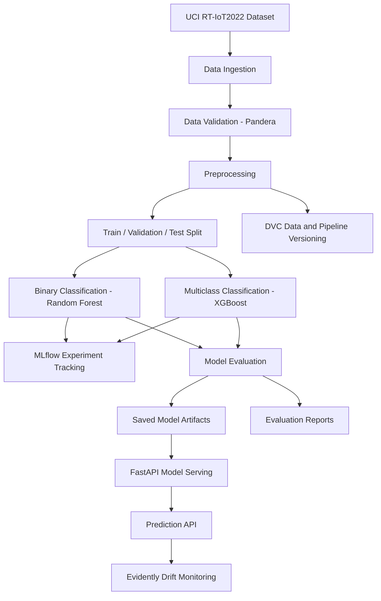

# SentinelML – Automated Network Intrusion Detection Platform

An end-to-end Machine Learning Operations (MLOps) project for network intrusion detection using the UCI RT-IoT2022 dataset.

SentinelML implements binary and multiclass network traffic classification, experiment tracking, data and pipeline versioning, model evaluation, REST API inference, automated testing, and data drift monitoring.

> **Project status:** Core implementation completed. Local development and monitoring demonstration. Not a live packet-capture system or certified production intrusion detection system.

---

## 1. Project Overview

Network intrusion detection involves identifying malicious activities from network traffic characteristics.

SentinelML uses machine learning to:

1. Identify whether network traffic is normal or an attack.
2. Classify traffic into specific attack categories.
3. Track experiments and model performance.
4. Version datasets and ML pipelines.
5. Serve trained models through a REST API.
6. Monitor changes in incoming feature distributions.

### Two classification tasks

| Task | Objective | Model |
|---|---|---|
| Binary classification | Normal vs Attack | Random Forest |
| Multiclass classification | Identify the traffic/attack category | XGBoost |

---

## 2. System Architecture



### Technologies

| Component | Technology |
|---|---|
| Programming language | Python |
| Data manipulation | Pandas, NumPy |
| Machine learning | Scikit-learn, XGBoost |
| Data validation | Pandera |
| Experiment tracking | MLflow |
| Data and pipeline versioning | DVC |
| API development | FastAPI |
| API testing | HTTPX |
| Data drift monitoring | Evidently |
| Automated testing | Pytest |
| Version control | Git |

---

## 3. Dataset

**Dataset:** RT-IoT2022

**Source:** UCI Machine Learning Repository

Dataset link: https://archive.ics.uci.edu/dataset/942/rt-iot2022

The dataset contains network traffic observations with numerical and categorical features.

### Dataset statistics

| Description | Count |
|---|---:|
| Original records | 123,117 |
| Original features | 83 |
| Target column | Attack_type |
| Target classes | 12 |
| Ambiguous records removed | 128 |
| Final modeling records | 122,989 |
| Model input features | 82 |

The original dataset contains 83 input features. One constant feature (`bwd_URG_flag_count`) was removed, leaving 82 model input features.

### Target classes

- ARP_poisioning
- DDOS_Slowloris
- DOS_SYN_Hping
- MQTT_Publish
- Metasploit_Brute_Force_SSH
- NMAP_FIN_SCAN
- NMAP_OS_DETECTION
- NMAP_TCP_scan
- NMAP_UDP_SCAN
- NMAP_XMAS_TREE_SCAN
- Thing_Speak
- Wipro_bulb

### Data splitting

| Split | Records |
|---|---:|
| Training | 78,712 |
| Validation | 19,679 |
| Test | 24,598 |

A split manifest stores the original positional indices to ensure consistent reconstruction of the partitions.

**Data quality considerations:**

- 128 ambiguous records were excluded because identical feature vectors were associated with different target labels.
- The dataset contains substantial class imbalance.
- No missing values were found in the final modeling dataset.
- The test partition was inspected during earlier experimentation and is not a pristine first-use holdout.

---

## 4. Data Preprocessing

The preprocessing pipeline includes:

- Numerical and categorical feature separation.
- Numerical median imputation.
- Standard scaling for numerical features.
- Categorical most-frequent imputation.
- One-hot encoding for categorical features.
- Unknown-category handling during inference.
- Consistent feature ordering and validation.

The preprocessing steps are embedded inside the trained model pipelines to ensure consistent transformations during training and inference.

---

## 5. Machine Learning Models

### A. Binary Classification

**Objective:** Classify network traffic into:

- Normal
- Attack

Model: Random Forest Classifier

The binary target groups the following categories as Normal:

- MQTT_Publish
- Thing_Speak
- Wipro_bulb

All remaining categories are grouped as Attack.

Class weighting is used to address class imbalance.

### B. Multiclass Classification

**Objective:** Predict one of the 12 traffic categories.

Model: XGBoost Classifier

Training incorporates class-aware sample weighting to address the substantial imbalance between attack categories.

---

## 6. Model Evaluation

The following metrics are used:

- Accuracy
- Balanced Accuracy
- Precision
- Recall
- Macro F1-score
- Weighted F1-score
- Confusion Matrix

### Test results

| Metric | Binary Random Forest | Multiclass XGBoost |
|---|---:|---:|
| Accuracy | 99.81% | 99.82% |
| Balanced Accuracy | 99.79% | 96.32% |
| Macro F1-score | 99.48% | 95.53% |
| Weighted F1-score | 99.81% | 99.82% |

### Interpretation

The binary model achieves strong performance across both classes.

The multiclass model also achieves high overall accuracy. However, macro F1 and balanced accuracy are lower than weighted F1, reflecting the challenges associated with class imbalance and rare attack categories.

Some rare classes have very few test observations, so their individual metrics should be interpreted cautiously.

Evaluation outputs are generated under:

`reports/metrics/`

---

## 7. MLflow Experiment Tracking

MLflow is used to track training experiments.

Separate experiments are maintained for:

- SentinelML_Binary_Classification
- SentinelML_Multiclass_Classification

Tracked information includes:

- Model parameters
- Training metadata
- Validation metrics
- Experiment run information

The tracking database is stored locally and excluded from Git.

Start the MLflow UI:

```bash
mlflow ui
```

Open:

http://127.0.0.1:5000

---

## 8. DVC – Data and Pipeline Versioning

DVC is used to manage dataset versions and reproducible training/evaluation stages.

Tracked data includes:

- Original RT-IoT2022 dataset
- Modeling dataset
- Ambiguous records
- Split manifest

The DVC pipeline defines:

1. Training stage
2. Evaluation stage

### Useful commands

Check pipeline status:

```bash
dvc status
```

Check remote synchronization:

```bash
dvc status -c
```

Reproduce the complete pipeline:

```bash
dvc repro
```

Push DVC-managed files:

```bash
dvc push
```

Pull DVC-managed files:

```bash
dvc pull
```

**Storage note:** The development setup uses a local DVC remote. A separate shared remote must be configured for collaboration or reproduction from another machine. The local remote is not automatically available to GitHub users.

---

## 9. FastAPI Model Serving

FastAPI exposes the trained models through REST endpoints.

Start the API:

```bash
python -m uvicorn src.sentinelml.api:app --reload
```

API documentation:

http://127.0.0.1:8000/docs

### Available endpoints

| Method | Endpoint | Description |
|---|---|---|
| GET | `/` | Root endpoint |
| GET | `/health` | Health check |
| POST | `/predict/binary` | Binary classification |
| POST | `/predict/multiclass` | Multiclass classification |

The API loads the trained models once during application startup.

Input validation checks:

- Expected feature count
- Required feature names
- Numerical values
- Non-finite values
- Categorical values

The prediction endpoints return the predicted class and class probabilities.

A sample API payload is available at:

`data/processed/api_test_sample.json`

---

## 10. Data Drift Monitoring – Evidently

Evidently is used to compare reference and current feature distributions.

Two experiments are included:

### Experiment 1: Original distribution comparison

- Reference: Training partition
- Current: Test partition
- Sample size: 10,000 records per partition

The initial experiment identified one drifting feature:

`fwd_iat.min`

The overall dataset drift was not detected using the configured 0.5 threshold.

### Experiment 2: Synthetic drift simulation

A controlled experiment introduces artificial distribution changes:

- Numerical drift: Non-zero `fwd_iat.min` values multiplied by five.
- Categorical drift: A proportion of `proto` values replaced with the most frequent existing category.

The experiment tests whether Evidently identifies deliberately introduced feature changes.

Reports are generated under:

`reports/monitoring/`

**Important:** These experiments compare static dataset partitions and simulated changes. They do not represent live network traffic monitoring.

---

## 11. Automated Testing

Pytest is used to test the main project components.

Test modules:

- `test_data_validation.py`
- `test_preprocessing.py`
- `test_model_inference.py`
- `test_api.py`

Run the complete test suite:

```bash
python -m pytest -v
```

Latest verified result:

**45 passed, 1 warning**

The warning relates to a Starlette test-client deprecation notice.

---

## 12. Project Structure

```text
sentinelml-network-intrusion-detection/
│
├── artifacts/
│   └── .gitignore
│
├── configs/
│
├── data/
│   ├── raw/
│   ├── interim/
│   ├── processed/
│   └── monitoring/
│
├── notebooks/
│   ├── 01_dataset_understanding.ipynb
│   ├── 10. Binary Classification.ipynb
│   └── 11. Multiclass Classification.ipynb
│
├── reports/
│   ├── figures/
│   ├── metrics/
│   └── monitoring/
│
├── scripts/
│   └── create_api_sample.py
│
├── src/
│   └── sentinelml/
│       ├── __init__.py
│       ├── api.py
│       ├── config.py
│       ├── data_validation.py
│       ├── evaluate.py
│       ├── monitoring.py
│       ├── predict.py
│       ├── preprocessing.py
│       ├── synthetic_drift.py
│       └── train.py
│
├── tests/
│   ├── test_api.py
│   ├── test_data_validation.py
│   ├── test_model_inference.py
│   └── test_preprocessing.py
│
├── .dvc/
├── .gitignore
├── dvc.yaml
├── dvc.lock
├── requirements.txt
└── README.md
```

---

## 13. Installation and Execution

### Prerequisites

- Python 3.13.9
- Git
- DVC
- A suitable local environment for XGBoost and Scikit-learn

### Step 1: Clone the repository

```bash
git clone <YOUR_GITHUB_REPOSITORY_URL>
cd sentinelml-network-intrusion-detection
```

### Step 2: Create a virtual environment

Windows PowerShell:

```powershell
python -m venv .venv
.venv\Scripts\Activate.ps1
```

### Step 3: Install dependencies

```bash
python -m pip install --upgrade pip
pip install -r requirements.txt
```

### Step 4: Retrieve DVC-managed data

Configure an accessible DVC remote first.

Then:

```bash
dvc pull
```

### Step 5: Reproduce training and evaluation

```bash
dvc repro
```

### Step 6: Start the API

```bash
python -m uvicorn src.sentinelml.api:app --reload
```

---

## 14. Limitations

- The project uses a static research dataset rather than live network packet capture.
- The dataset has substantial class imbalance.
- Some rare classes have limited evaluation support.
- The test partition was previously inspected during experimentation.
- Drift monitoring is demonstrated using static partitions and synthetic changes.
- The local DVC remote is not a shared cloud storage solution.
- The API is a research and portfolio demonstration, not a production-hardened security service.

---

## 15. Future Improvements

Potential extensions include:

- Shared cloud-based DVC artifact storage.
- Cloud deployment of the FastAPI application.
- Continuous integration using GitHub Actions.
- Prediction distribution monitoring.
- Model performance monitoring using newly labelled traffic.
- Automated retraining and model promotion workflows.
- More realistic temporal drift experiments.

---

## 16. Author

**Kiran Prasanth**

M.Tech – Data Science

Amrita Vishwa Vidyapeetham, Bengaluru

Interested in Machine Learning, AI Engineering, MLOps, and Generative AI.

---

## License

Add an appropriate open-source license before publishing this repository if you intend to permit reuse.
